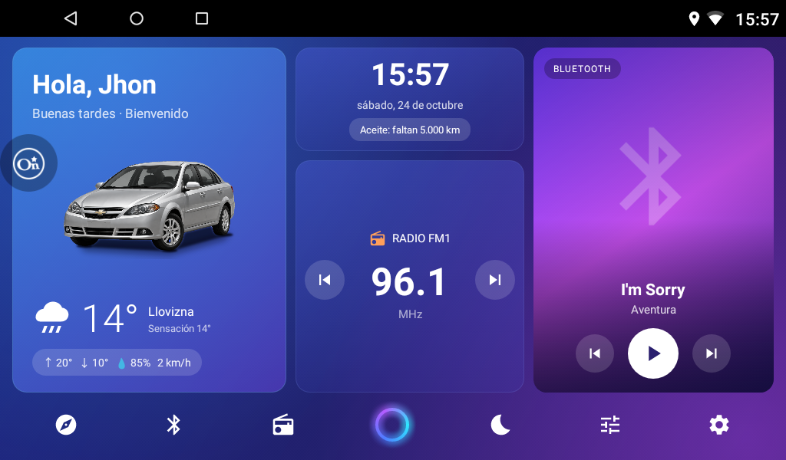

# Clean Launcher

[](https://github.com/jhontandazo008/CleanLauncher/actions/workflows/build.yml)



Launcher Android limpio, ligero y a medida para un radio de auto chino **NWD (Allwinner T3, Android 7.1.1)**
instalado en un Chevrolet Epica. Reemplaza el launcher de fábrica con una interfaz limpia y rápida
que se comunica directamente con los servicios propietarios del radio.

## Funciones

- **Pantalla principal** con barra lateral de atajos (inicio, mapa, teléfono, música, apps, ecualizador,
  apagar pantalla, ajustes), hora, fecha, aviso de aceite y temperatura exterior arriba, tarjeta de saludo con
  clima (Open-Meteo, por GPS o IP) y la foto del carro, tarjeta de navegación (mapa en vivo de OpenStreetMap que sigue tu GPS y gira con el rumbo; necesita internet,
  sin rutas: al tocarla abre la app de mapas; los mapas vienen de los servidores de OpenStreetMap, aptos para uso
  personal, y se guardan en caché hasta 60 MB), reproducción actual (las carátulas de Bluetooth y USB se buscan por internet en Deezer, por título y artista) y, a la derecha, accesos a Teléfono, Radio FM (con anterior/siguiente),
  Android Auto y un **velocímetro** por GPS (km/h). La temperatura "Exterior" sale del clima, no de un sensor del carro.
- **Radio FM**: dial, presets y sintonía hablando por Binder con `com.nwd.radio.service`.
- **Bluetooth**: teléfono (marcador, contactos) y música vía `com.bt.bc03`.
- **Overlay de volumen** propio (reemplaza el FloatBar de fábrica).
- **Modo pantalla apagada** que sigue respondiendo a los botones del volante.
- **Control de aceite / odómetro** con recordatorios de mantenimiento.
- **GreeterService**: saludo por voz al encender (voz Salomé, es-CO), avisos de cinturón,
  clima, mantenimiento los lunes y *restricción vehicular* según el último dígito de tu placa
  (lunes 1-2, martes 3-4, miércoles 5-6, jueves 7-8, viernes 9-0). Restaura la fuente de audio
  (radio o BT) al dar contacto. Los clips grabados dicen el nombre con el que se grabaron
  (`Profile.RECORDED_VOICE_NAME`); con cualquier otro nombre el saludo lo dice el TTS del equipo. Si grabas de nuevo
  los saludos (`res/raw/v_greet_*.mp3`) con tu nombre, cambia esa constante y volverá tu voz grabada.
  El nombre de la build personal es `Profile.OWNER_NAME`; se cambia también tocando la foto del carro.
- **Ecualizador** con balance/fader y ajuste automático por fuente.
- **Dispositivos Bluetooth**: lista de emparejados y conexión.
- **Configuración inicial** para instalaciones compartidas: nombre, foto del carro, voz, dígito de la placa
  (restricción vehicular) y permisos.
  En radios que no son NWD se ocultan las funciones que dependen de los servicios de fábrica.
- Cajón de aplicaciones.

### Novedades de la v1 (versión 7.0)

- **Faros y tema oscuro por hora:** sin el cable ILL conectado, el carro enciende los faros y la pantalla pasa al tema
  oscuro de 18:30 a 6:00 (`DayParts`). Si el cable ILL sí llega, también cuenta. El fondo claro cambia de tono entre
  amanecer, día y atardecer.
- **Viaje:** kilómetros, tiempo en marcha, velocidad promedio y máxima (`TripStats`). Tocar el recuadro de viaje
  muestra el detalle y permite reiniciarlo.
- **Aviso de descanso:** la voz avisa tras 2 horas de manejo seguido y cada 30 minutos después; una parada de 15 minutos
  reinicia la cuenta.
- **Alerta de velocidad:** tocar el velocímetro cambia el límite (apagado, 60, 80, 90, 100, 120). Al pasarlo, el arco se
  pone rojo y la voz avisa (como máximo una vez por minuto).
- **Modo conducción:** pasando de 10 km/h la tarjeta del saludo se cambia por una con la velocidad grande y los datos del
  viaje; vuelve tras unos 15 segundos parado. Se puede apagar en Configurar.
- **Teléfono:** muestra el nombre del celular conectado y, con favoritos guardados en Configurar, un toque ofrece
  llamarlos.
- **Lluvia próxima:** una línea en la tarjeta del clima y un aviso por voz cuando hay al menos 60 % de probabilidad en
  las próximas 6 horas.
- **Documentos del carro** (seguro, matrícula, revisión técnica): se guardan las fechas; la pantalla avisa 30 días antes
  y la voz, 7 días antes. Se abren desde el botón del carro.
- **Perfiles de sonido** Normal / Graves / Voz con un toque en la tarjeta de música.
- **Botón de apagar la radio** en el recuadro de Radio: cambia la fuente de audio a la del reproductor local, que está
  en silencio, y la vuelve a poner. Sin probar en todos los radios: el registro es `adb logcat -s RadioPower`.
- Pruebas en Java puro (`sh test.sh`) para el pico y placa, las partes del día, el viaje y las fechas de documentos.

### Nuevo diseño

- **Tarjeta del carro** con la foto a todo el fondo (`res/drawable-nodpi/duster.jpg`) y degradados para leer el saludo y el clima.
  Si el usuario elige su propia foto en Configurar, se mantiene el carro pequeño y centrado.
- **Tema azul tipo vidrio**, de día y de noche, en todas las pantallas (`Ui.background`, `Ui.card`, `Ui.glassTint`).
- **Barra lateral con nombres** y **barra de apps al pie** (`DockBar`): YouTube, Netflix, Disney+, Play Store, Maps, Radio,
  Chrome, Spotify y Waze con su ícono real; solo aparecen las que estén instaladas. Para cambiarlas, edita `ENTRIES` en `DockBar.java`.

## Compilar

No usa Gradle: [`build.sh`](build.sh) llama directamente a `aapt2`, `javac`, `d8`, `zipalign` y
`apksigner`. Funciona en Linux, macOS y Windows (Git Bash).

### Requisitos

| Herramienta | Versión | Notas |
|---|---|---|
| JDK | 17 o superior | Sirve el JBR que trae Android Studio |
| Android SDK Platform | `android-33` | Solo para compilar. El APK corre en Android 7.1+ (minSdk 25) |
| Android SDK Build-Tools | 36.0.0 (probado) | El script usa la más nueva instalada |
| Platform-Tools (`adb`) | cualquiera | Solo para `install` |

### Desde una instalación limpia

1. Instala un JDK 17+ y las [herramientas de línea de comandos del Android SDK](https://developer.android.com/studio#command-tools)
   (o Android Studio, que trae ambos).
2. Instala los paquetes del SDK:
   ```sh
   sdkmanager "platforms;android-33" "build-tools;36.0.0" "platform-tools"
   ```
3. Indica dónde está el SDK si no está en la ruta por defecto de Android Studio:
   ```sh
   export ANDROID_HOME=$HOME/Android/Sdk
   ```
4. Compila:
   ```sh
   sh build.sh                            # genera build/CleanLauncher.apk
   sh build.sh install                    # además lo instala con adb
   RADIO=192.168.1.15:5555 sh build.sh install   # radio por ADB Wi-Fi
   ```

Si falta algo, el script se detiene y dice qué instalar. Detecta el SDK con `ANDROID_HOME` o
`ANDROID_SDK_ROOT` (o las rutas por defecto de Android Studio) y el JDK con `JAVA_HOME`, `javac`
en el `PATH` o el JBR de Android Studio. Variables opcionales: `ANDROID_PLATFORM`, `BUILD_TOOLS`,
`KEYSTORE`, `KEYSTORE_PASS`, `KEY_ALIAS`.
`VARIANT=share sh build.sh` genera `CleanLauncher-compartir.apk`, una versión para regalar sin las fotos
del carro (`res/drawable-nodpi/duster*`) ni las voces grabadas: usa la foto del usuario y el texto a voz del equipo. Si no existe `~/.android/debug.keystore`, el script lo crea.

### Integración continua

Cada push a `main` y cada pull request se compila en GitHub Actions
([`.github/workflows/build.yml`](.github/workflows/build.yml)). El APK queda como artefacto
descargable en la pestaña **Actions** del repo. Está firmado con una clave de debug, salvo que definas los secretos `KEYSTORE_BASE64`, `KEYSTORE_PASS` y
`KEY_ALIAS` en el repo: entonces usa esa llave fija y cada APK de CI puede actualizar al anterior sin desinstalar.
Antes de compilar corre `sh test.sh` (pruebas en Java puro, sin Android SDK).

## Integración con el radio NWD

| Qué | Cómo |
|---|---|
| Cambio de fuente de audio | broadcast `com.nwd.action.ACTION_REQUEST_CHANGE_SOURCE` (radio=8, BT música=15, USB=2) |
| Radio | Binder crudo a `com.nwd.radio.service` (`RadioClient`) |
| Bluetooth | Binder crudo a `com.bt.bc03` (`BtClient`) |
| Voz sobre la radio | launcher añadido a `/nwdappconfig/app/NaviSound.ini` |
| No ser cerrado en segundo plano | añadido a `BackgroundManager.ini` y `OneClearConfig.xml` |

## Cambios hechos al radio (todos reversibles)

- Deshabilitado bloatware de fábrica (apps de prueba, DiDi, voz, anuncios CaradService, carstore, Aptoide).
- Deshabilitados componentes del launcher de fábrica: FloatBar, WeatherService, SmallPackageUpdater, AMap APSService.
  **No** se deshabilita `com.android.launcher` completo (aloja el aprendizaje de botones del volante y el apagado de pantalla).
- Animaciones a 0.5x.
- Archivos de configuración modificados: los originales están en [`backup/`](backup/).

Para revertir: copiar los `.bak` de `backup/` a `/nwdappconfig/app/` y volver a habilitar los paquetes con
`adb shell pm enable <paquete>`.
